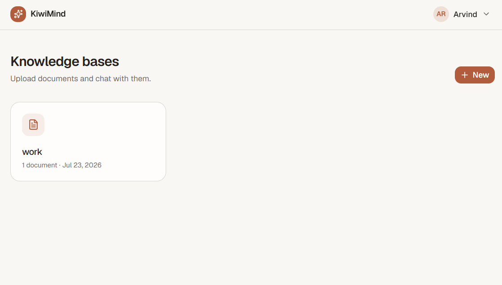
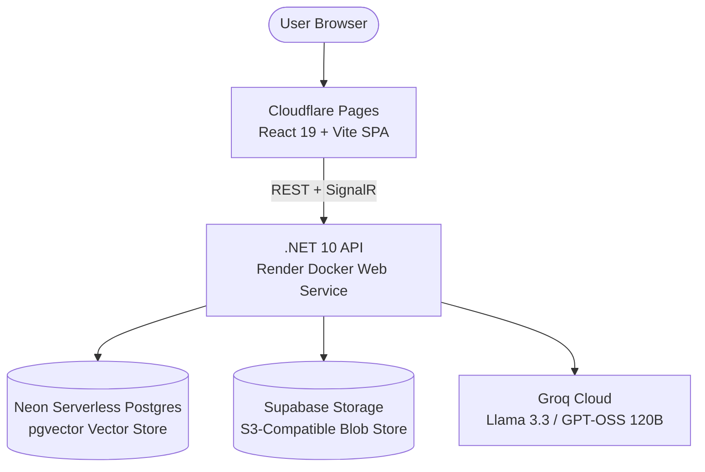
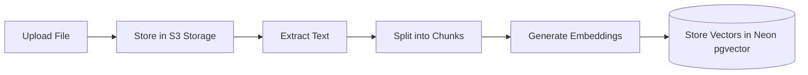
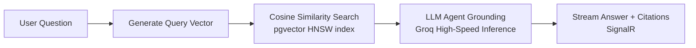

# KiwiMind

**Chat with your documents.** Upload your files, ask questions in plain English, and get streaming answers drawn straight from *your* content — with interactive citations pointing back to the exact source.

[](https://kiwimind-6d1.pages.dev/knowledge-bases)
[](https://github.com/arvind05094/kiwiMind)
[](https://www.linkedin.com/in/arvind-chauhan-dev/)

---

### 🌐 [Click here for Live Demo](https://kiwimind-6d1.pages.dev/knowledge-bases)

> 💡 **Try it in 60 seconds (No verification needed):**
> 1. Open the [live demo](https://kiwimind-6d1.pages.dev/knowledge-bases) and register with any email + password.
> 2. Create a **Knowledge Base** (e.g., *"Product Docs"* or *"Research"*).
> 3. Upload a document (PDF, DOCX, TXT, or Markdown).
> 4. Switch to the **Conversations** tab, click **+ New**, and ask any question about your document!


*Ask questions in natural language and get answers grounded in your documents — every response links back to its source, and follow-up questions maintain full context.*

|  |  |
|---|---|
|  |  |
| *Your knowledge bases — scoped document collections* | *Inside a knowledge base — uploads with live status* |

---

## What is KiwiMind?

Imagine having a stack of lengthy documents — technical manuals, contracts, policy guides, or research papers — and needing immediate answers without reading through hundreds of pages. 

KiwiMind is a full-stack **RAG (Retrieval-Augmented Generation)** platform built from scratch to show modern AI engineering end-to-end:
1. **Upload** documents (PDF, Word, or plain text).
2. **Ask** questions naturally (e.g., *"What is the warranty period and who signed the contract?"*).
3. **Get streaming, cited answers** backed by **citation chips** linking back to the exact passage in your document.

**Why RAG matters:** Instead of the AI hallucinating facts, every answer is strictly *grounded* in the uploaded source text.

---

## Key Features

- 🔐 **Multi-Tenant Security** — Documents and conversations are strictly isolated per user account.
- 📚 **Scoped Knowledge Bases** — Organize files into distinct domains so the agent only searches relevant content.
- 📄 **Background Document Ingestion** — Automatic PDF/DOCX/TXT text extraction, intelligent chunking, and vector embedding.
- 💬 **Grounded Answers with Citations** — Inline source tags `[1]`, `[2]` showing the exact file and excerpt.
- 🤖 **Agentic Capabilities** — Semantic Kernel agent supporting multi-tool reasoning (search, summarize document, compare documents, view metadata).
- ⚡ **Real-time SignalR Streaming** — Responses stream token-by-token in real time.
- 🛡️ **Zero-Downtime Graceful Fallback** — Built-in resilience that automatically falls back to grounded document excerpts if third-party AI rate limits are reached.

---

## Architecture & Data Flow



### Ingestion Flow (Background)


### Retrieval & Answer Flow


---

## Tech Stack

| Layer | Technology |
|---|---|
| **Frontend** | React 19, TypeScript, Vite, TanStack Query, Tailwind CSS v4, shadcn/ui |
| **Backend** | .NET 10, ASP.NET Core Web API, Clean Architecture, CQRS (MediatR), EF Core (Npgsql) |
| **Database & Vectors** | PostgreSQL 16 + **`pgvector`** on **Neon** (cosine similarity, HNSW index) |
| **Blob Storage** | **Supabase Storage** (S3-compatible, `AWSSDK.S3`) |
| **AI & LLM** | **Groq** (GPT-OSS 120B / Llama 3) + Semantic Kernel tool-calling agent |
| **Real-time** | **ASP.NET Core SignalR** (live token streaming) |
| **Authentication** | JWT (access & refresh tokens), BCrypt password hashing |
| **Hosting ($0/mo)** | **Cloudflare Pages** (frontend) + **Render** (containerized API) |
| **Testing** | xUnit, Testcontainers, RAG evaluation harness |

---

## Engineering Highlights

- **Native Vector Database**: Embeddings are stored natively in PostgreSQL using the `pgvector` extension with vector indexing, executing similarity searches directly in SQL rather than application memory.
- **Agentic Tool-Calling**: Uses Microsoft Semantic Kernel to choose among specialized tools (`search_knowledge_base`, `summarize_document`, `compare_documents`, `get_document_metadata`, `list_documents`) dynamically.
- **Clean Architecture & CQRS**: Separation of concerns with Domain, Application, Infrastructure, and API layers using MediatR.
- **Production Resilience**: Multi-tenant isolation, rate limiting on auth and chat endpoints, file size verification, and graceful fallback to direct citations under high load.
- **RAG Evaluation Suite**: Includes a Testcontainers-backed evaluation harness to measure and prevent retrieval regression.

---

## Running Locally

### Prerequisites
- Docker Desktop
- .NET 10 SDK
- Node.js 22+

### 1. Start Database & Infrastructure
```bash
docker compose up -d
```

### 2. Run the Backend API
```bash
dotnet run --project src/KiwiMind.Api
```
The API starts at `http://localhost:8080`.

### 3. Run the Frontend
```bash
cd frontend
npm install
npm run dev
```
The application opens at `http://localhost:5173`.

### 4. Run the Test Suite
```bash
dotnet test
```

---

## Author & Contact

**Arvind Chauhan**
- **LinkedIn**: [linkedin.com/in/arvind-chauhan-dev](https://www.linkedin.com/in/arvind-chauhan-dev/)
- **GitHub**: [@arvind05094](https://github.com/arvind05094)
- **Live Demo**: [kiwimind-6d1.pages.dev](https://kiwimind-6d1.pages.dev/knowledge-bases)
