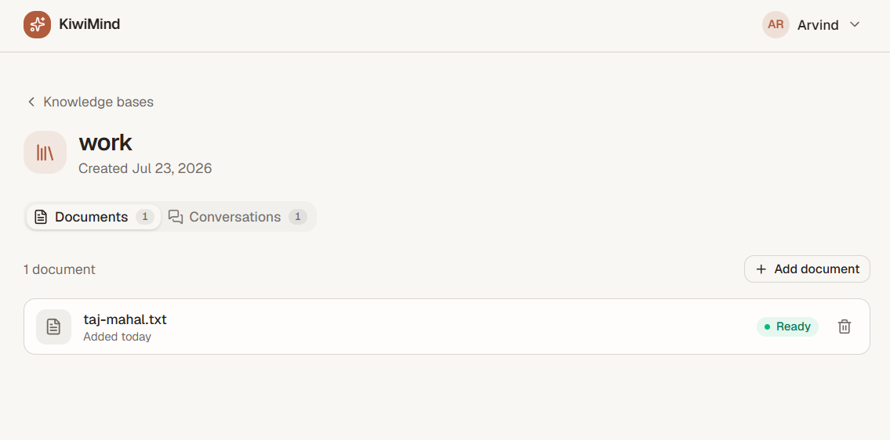
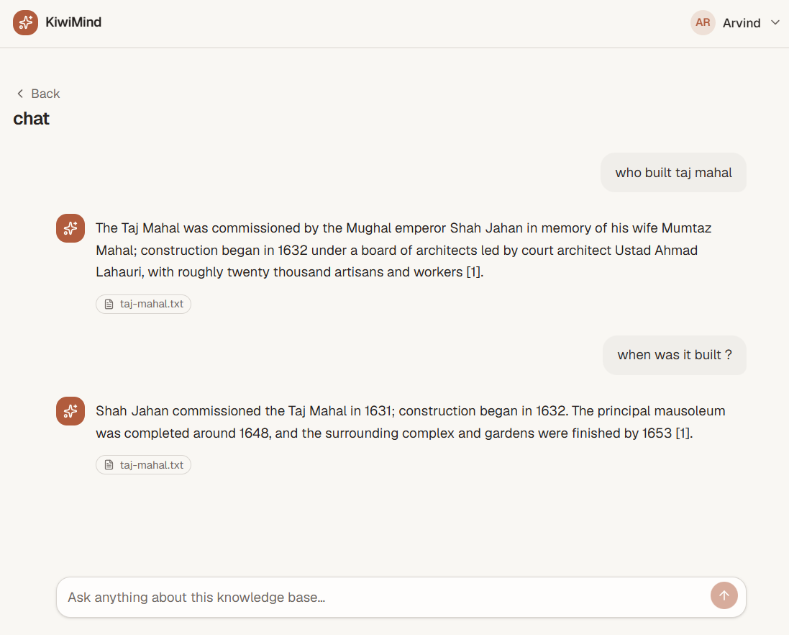
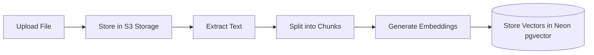
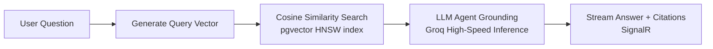

# KiwiMind

KiwiMind is a full-stack Retrieval-Augmented Generation (RAG) platform. It allows users to upload documents (PDF, DOCX, TXT) and interact with them using natural language, receiving real-time, token-by-token streaming answers grounded strictly in the provided text, complete with exact source citations.

**Links:**

* **Live Demo:** [kiwimind-6d1.pages.dev/knowledge-bases](https://kiwimind-6d1.pages.dev/knowledge-bases)
* **API Documentation:** [Render Scalar Docs](https://kiwimind.onrender.com/scalar)

*Note: The backend is hosted on a free cloud tier that sleeps when idle; the initial request may take approximately 10 seconds to process.*

---

| | |
|:---:|:---:|
|  |  |
| *Inside a knowledge base — uploads with live status* | *Chat with grounded answers and citations* |

---

## Core Features

* **Grounded Answers with Citations:** Every AI response includes inline citation chips linking back to the exact passage in the uploaded document, eliminating AI hallucination.


* **Real-time SignalR Streaming:** Answers stream instantly, token-by-token, providing a fluid, ChatGPT-like conversational experience.


* **Background Document Ingestion:** The platform automatically handles text extraction, intelligent chunking, and vector embedding for all uploaded files.


* **Agentic Capabilities:** A Semantic Kernel agent powers multi-tool reasoning, enabling the system to search, summarize, compare, and retrieve metadata across documents.


* **Scoped Knowledge Bases:** Documents are organized into distinct domains to ensure the agent only searches contextually relevant content.


## Architecture

**Infrastructure & Data Flow**


**Ingestion Flow**



**Retrieval & Answer Flow**



## Technology Stack

* **Backend:** .NET 10, ASP.NET Core Web API, Clean Architecture, CQRS (MediatR)


* **Frontend:** React 19, TypeScript, Vite, TanStack Query, Tailwind CSS v4, shadcn/ui


* **Database & Vectors:** PostgreSQL 16 on Neon, utilizing `pgvector` for cosine similarity and HNSW indexing


* **AI & LLM:** Groq (GPT-OSS 120B / Llama 3) integrated with Microsoft Semantic Kernel


* **Real-time & Storage:** ASP.NET Core SignalR, Supabase Storage (S3-compatible via `AWSSDK.S3`)


## Engineering Highlights

* **Native Vector Database Integration:** Vector embeddings are stored and queried natively within PostgreSQL using the `pgvector` extension, executing similarity searches directly at the database level rather than in application memory.


* **Agentic Tool-Calling:** The system utilizes Microsoft Semantic Kernel to dynamically choose specialized tools (`search_knowledge_base`, `summarize_document`, `compare_documents`, etc.) based on the user's intent.


* **Production Resilience:** Features multi-tenant data isolation, rate limiting on authentication and chat endpoints, and graceful fallback to direct citations if third-party AI rate limits are exceeded.


* **Clean Architecture:** Strict separation of concerns across Domain, Application, Infrastructure, and API layers using CQRS and MediatR.


## Local Development

Prerequisites for local deployment include Docker Desktop, the .NET 10 SDK, and Node.js 22+.

```bash
# Start Database & Infrastructure
docker compose up -d

# Configure and run the Backend API
cd src/KiwiMind.Api
cp .env.example .env # Fill in your local credentials here
dotnet run

# Configure and run the Frontend (from the project root)
cd frontend
cp .env.example .env # Fill in your local credentials here
npm install
npm run dev
```

## Contact

Arvind Chauhan

* **LinkedIn:** [linkedin.com/in/arvind-chauhan-dev](https://www.linkedin.com/in/arvind-chauhan-dev/)
* **Email:** [arvind05094@gmail.com](mailto:arvind05094@gmail.com)